# Manual Book Operasional INAGRO Kuesioner

Dokumen ini menjelaskan penggunaan aplikasi Kuesioner INAGRO. Seluruh gambar merupakan tangkapan layar aplikasi web. Nilai angka pada gambar adalah contoh data pengembangan, bukan nilai tetap.

Alamat aplikasi ditulis sebagai:

```text
https://domain-anda
```

Jika gambar menampilkan alamat pengembangan, alamat tersebut hanya berlaku pada gambar.

## Daftar Isi

1. [Informasi Dokumen](#1-informasi-dokumen)
2. [Login](#2-login)
3. [Dashboard](#3-dashboard)
4. [Kategori](#4-kategori)
5. [Soal](#5-soal)
6. [Kuesioner](#6-kuesioner)
7. [Form Publik](#7-form-publik)
8. [Respons](#8-respons)
9. [Export Excel dan Looker](#9-export-excel-dan-looker)
10. [Pengguna](#10-pengguna)
11. [Role dan Permission](#11-role-dan-permission)
12. [Troubleshooting](#12-troubleshooting)
13. [Lampiran](#13-lampiran)

---

## 1. Informasi Dokumen

### 1.1 Tujuan

Manual ini digunakan untuk:

- mengoperasikan halaman admin
- membuat dan menerbitkan kuesioner
- membagikan tautan dan QR kepada responden
- memeriksa, mengoreksi, dan mengekspor respons
- mengelola pengguna dan role.

### 1.2 Role aplikasi

| Role | Fungsi utama |
|---|---|
| Super Admin | Akses penuh, termasuk pengelolaan role |
| Admin | Mengelola kategori, soal, kuesioner, respons, dan pengguna |
| Operator | Melihat data, mengoreksi nama/sekolah respons, dan mengekspor respons |
| Viewer | Melihat dashboard, kategori, soal, kuesioner, dan respons tanpa mengubah data |

Super Admin memiliki akses penuh melalui mekanisme bypass pada Gate. Role lain mengikuti permission yang diberikan.

### 1.3 Istilah

| Istilah | Arti |
|---|---|
| Kategori | Kelompok soal yang menjadi satu langkah wizard |
| Soal | Pertanyaan dengan tipe, skala, atau opsi |
| Kuesioner | Wadah soal, identitas responden, jadwal, dan tautan publik |
| Snapshot | Salinan isi soal dan group saat kuesioner dipublikasikan |
| Draft | Respons yang belum dikirim |
| Submitted | Respons yang sudah dikirim |
| Soft delete | Data dipindahkan ke daftar terhapus dan masih dapat dipulihkan |
| Force delete | Data dihapus permanen |
| Restore | Mengembalikan data yang soft-deleted |

---

## 2. Login

Halaman login digunakan untuk masuk ke panel admin.

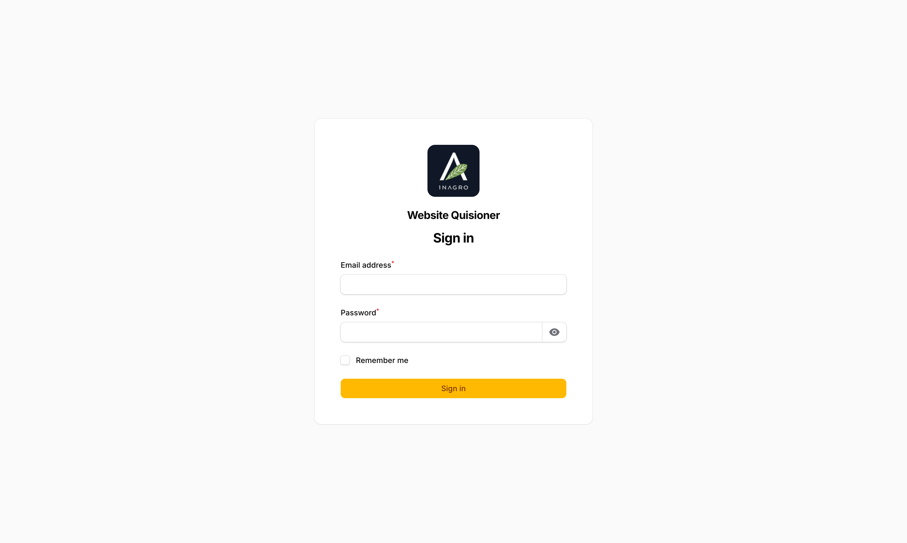

### 2.1 Fungsi elemen gambar

| Elemen | Fungsi |
|---|---|
| Logo INAGRO | Identitas aplikasi |
| Email | Alamat email pengguna |
| Password | Kata sandi pengguna |
| Sign in | Memproses login |

### 2.2 Cara login

1. Buka `https://domain-anda`.
2. Isi **Email**.
3. Isi **Password**.
4. Klik **Sign in**.

Pengguna yang berhasil login diarahkan ke Dashboard.

Aplikasi tidak menyediakan fitur lupa password atau reset password mandiri. Password diubah oleh admin melalui halaman Pengguna.

### 2.3 Login gagal

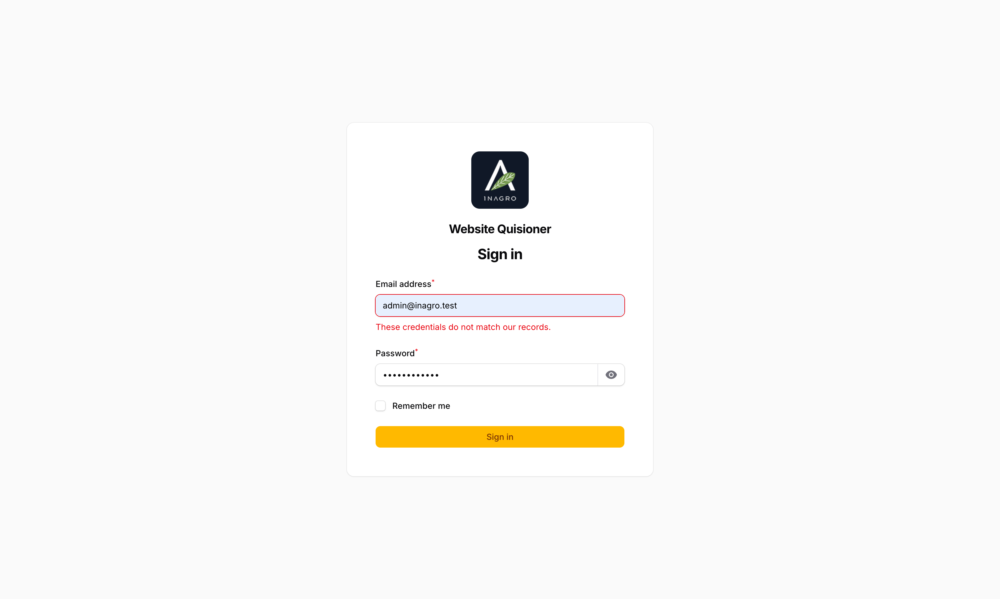

Pesan pada gambar muncul ketika email atau password tidak sesuai. Periksa kembali data login. Jika akun dinonaktifkan, sistem menampilkan pesan:

```text
Akun dinonaktifkan, hubungi admin.
```

Hubungi Super Admin atau Admin untuk mengaktifkan akun.

---

## 3. Dashboard

Dashboard menampilkan ringkasan data kuesioner.

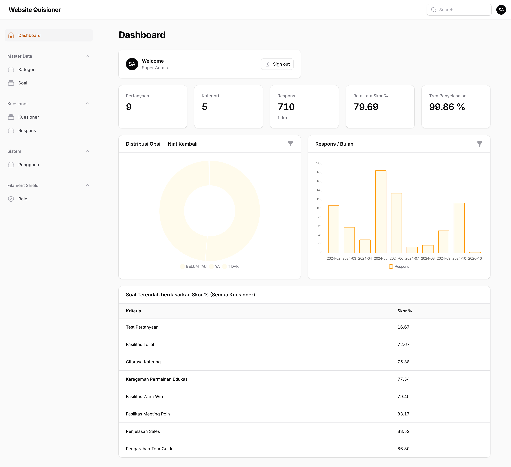

### 3.1 Fungsi elemen gambar

| Elemen | Fungsi |
|---|---|
| Menu Dashboard | Membuka halaman ringkasan |
| Welcome | Menampilkan pengguna yang sedang login |
| Sign out | Keluar dari aplikasi |
| Pertanyaan | Jumlah soal pada master data |
| Kategori | Jumlah kategori pada master data |
| Respons | Jumlah respons submitted. Jumlah draft ditampilkan di bawah angka |
| Rata-rata Skor % | Rata-rata skor numerik dari respons submitted |
| Tren Penyelesaian | Persentase submitted dibanding submitted dan draft |
| Distribusi Opsi | Diagram distribusi jawaban radio/select |
| Respons / Bulan | Diagram jumlah respons per bulan |
| Soal Terendah berdasarkan Skor % | Daftar soal dengan rata-rata skor terendah |
| Ikon filter | Membuka filter pada widget terkait |

### 3.2 Rumus

Normalisasi skor:

```text
Skor % = ((nilai - skala_min) / (skala_max - skala_min)) × 100
```

Aturan:

- hasil dibulatkan dua desimal
- nilai kosong tidak dihitung
- jika `skala_max <= skala_min`, nilai tidak dihitung.

Rumus widget:

| Widget | Perhitungan |
|---|---|
| Rata-rata Skor % | `AVG((value_number - scale_min) / (scale_max - scale_min)) × 100` dari jawaban numerik submitted. Respons soft-deleted dikecualikan |
| Tren Penyelesaian | `submitted / (submitted + draft) × 100` |
| Soal Terendah | Rata-rata Skor % per soal, diurutkan dari nilai terkecil |
| Distribusi Opsi | Jumlah jawaban per `value_option` |
| Respons / Bulan | Jumlah submitted per bulan berdasarkan `COALESCE(visit_date, created_at)` |

Catatan implementasi:

- Statistik atas dan Soal Terendah bersifat global untuk semua kuesioner.
- Distribusi Opsi dan Respons/Bulan memiliki filter sendiri.
- Widget hanya tampil jika pengguna memiliki permission widget terkait.

### 3.3 Filter Distribusi Opsi

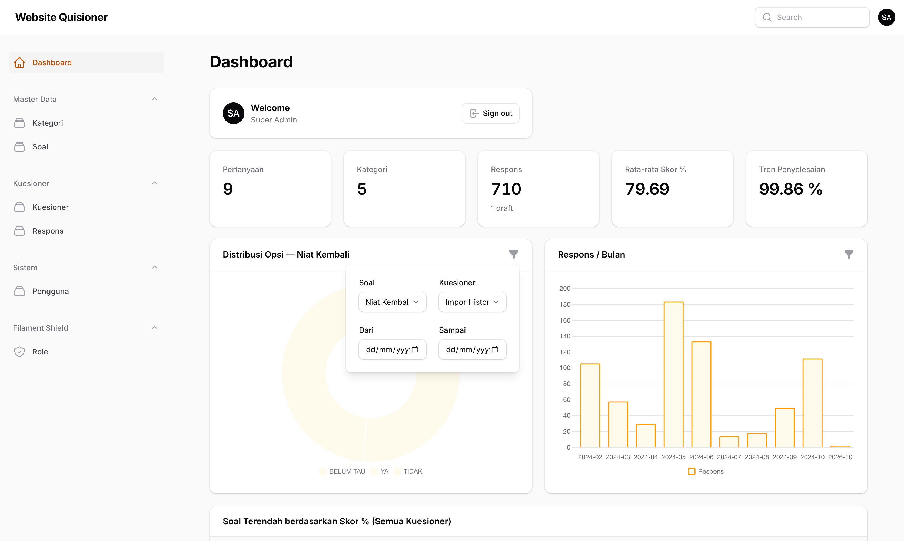

| Filter | Opsi | Perilaku |
|---|---|---|
| Soal | Daftar soal bertipe `radio` atau `select` dari snapshot kuesioner yang dipilih | Jika Kuesioner belum dipilih, daftar Soal kosong |
| Kuesioner | `Semua` dan daftar seluruh judul kuesioner | `Semua` menampilkan seluruh kuesioner |
| Dari | Date picker | Batas awal `visit_date` |
| Sampai | Date picker | Batas akhir `visit_date` |

Catatan: pilih **Kuesioner** terlebih dahulu agar daftar **Soal** terisi.

Langkah:

1. Pilih **Kuesioner**.
2. Pilih **Soal**.
3. Isi **Dari** dan **Sampai** bila diperlukan.
4. Klik di luar panel filter untuk menerapkan.

### 3.4 Filter Respons per Bulan

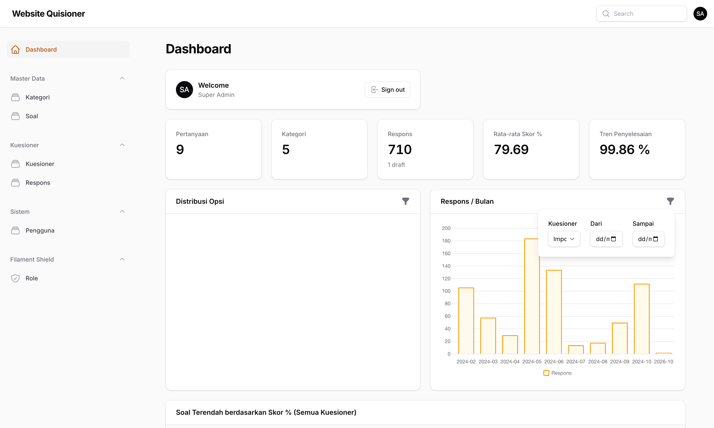

| Filter | Opsi | Perilaku |
|---|---|---|
| Kuesioner | `Semua` dan daftar seluruh judul kuesioner | `Semua` menampilkan seluruh kuesioner |
| Dari | Date picker | Batas awal tanggal |
| Sampai | Date picker | Batas akhir tanggal |

Tanggal memakai `visit_date`. Jika kosong, sistem memakai `created_at`.

Catatan:

- `StatsOverview` dan `Soal Terendah` tidak memiliki filter.
- Keduanya menampilkan data global semua kuesioner.
- Filter hanya tersedia pada widget Distribusi Opsi dan Respons/Bulan.

### 3.5 Permission widget

Widget dashboard memiliki permission berikut:

```text
View:StatsOverview
View:ResponsesPerMonthChart
View:OptionDistributionChart
View:LowestCriteriaTable
```

Role Admin, Operator, dan Viewer mendapatkan keempat permission tersebut secara default. Jika permission dicabut, widget terkait tidak tampil pada dashboard pengguna.

---

## 4. Kategori

Kategori adalah kelompok soal. Satu kategori menjadi satu langkah pada form publik.

### 4.1 Halaman utama

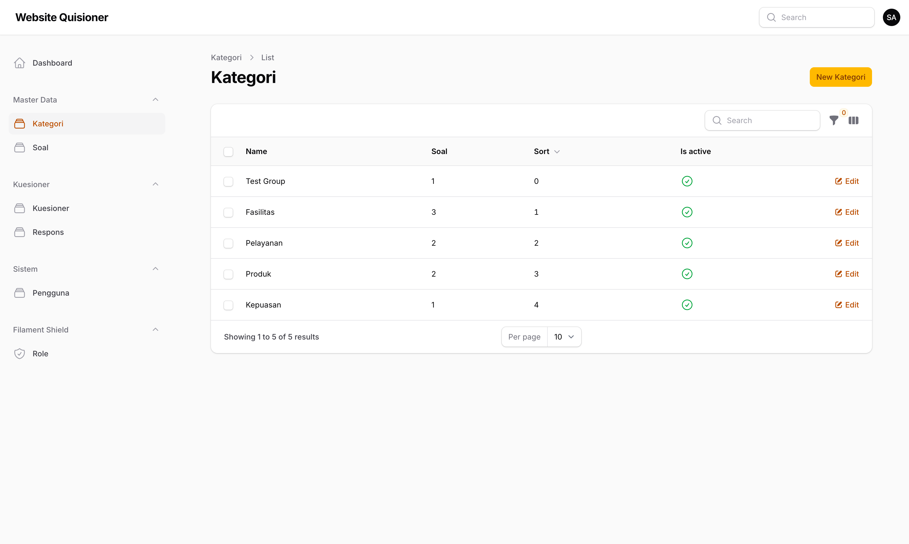

| Elemen | Fungsi |
|---|---|
| New Kategori | Membuka form tambah kategori |
| Search | Mencari nama kategori |
| Filter | Membuka filter data terhapus |
| Column manager | Menampilkan atau menyembunyikan kolom |
| Nama | Nama kategori |
| Soal | Jumlah soal pada kategori |
| Urutan | Nilai urutan kategori |
| Aktif | Status kategori |
| Edit | Membuka form edit |

### 4.2 Filter

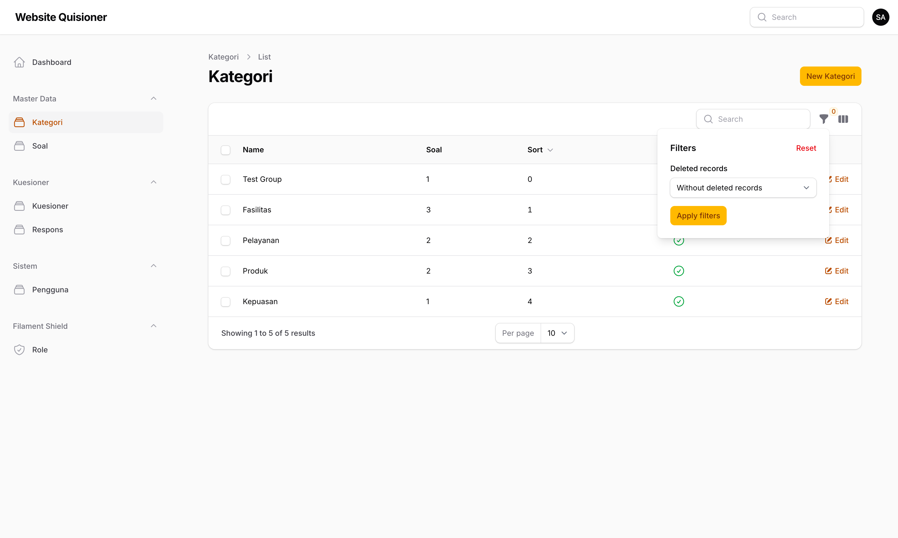

Filter **Deleted records** menentukan data yang ditampilkan:

- **Without deleted records**: hanya data aktif.
- **With deleted records**: data aktif dan soft-deleted.
- **Only deleted records**: hanya data soft-deleted.

Klik **Apply filters** untuk menerapkan dan **Reset** untuk mengembalikan filter.

### 4.3 Column manager

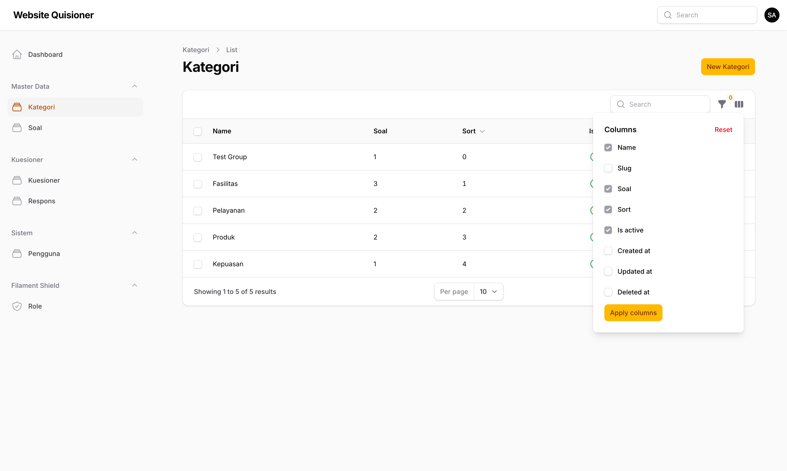

Column manager digunakan untuk menampilkan atau menyembunyikan kolom. Pengaturan ini tidak mengubah data.

### 4.4 Tambah kategori

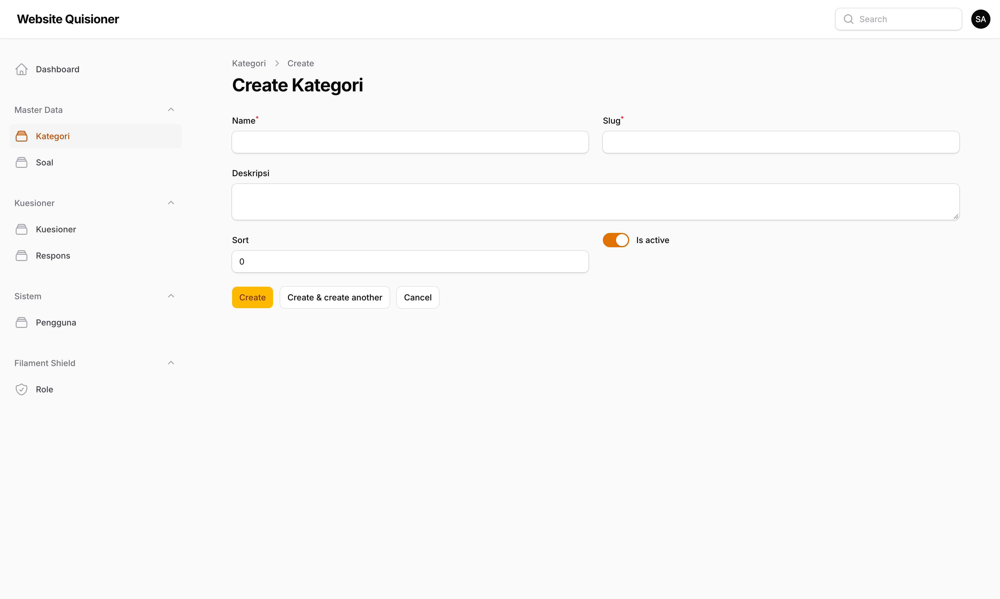

| Field | Keterangan |
|---|---|
| Nama | Wajib diisi. Slug dibuat otomatis |
| Slug | Wajib dan unik |
| Deskripsi | Opsional. Tampil di atas soal pada form publik |
| Urutan | Angka urutan kategori |
| Aktif | Menentukan kategori tersedia untuk kuesioner baru |

Langkah:

1. Klik **New Kategori**.
2. Isi **Nama**.
3. Periksa **Slug**.
4. Isi **Deskripsi** bila diperlukan.
5. Atur **Urutan**.
6. Aktifkan **Aktif**.
7. Klik **Create**.

### 4.5 Edit dan delete

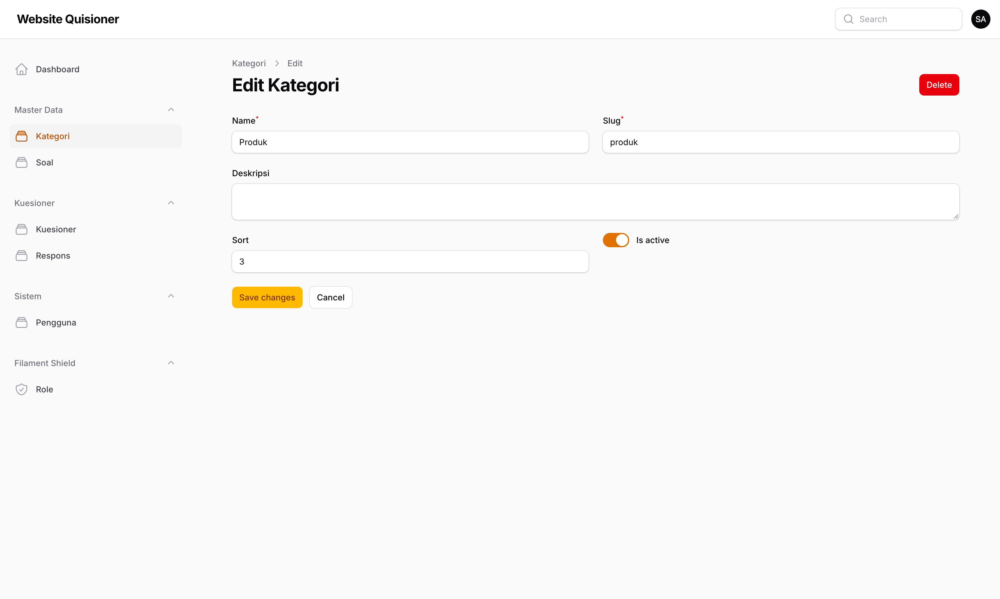

Langkah edit:

1. Klik **Edit** pada baris kategori.
2. Ubah data.
3. Klik **Save changes**.

Delete adalah soft delete. Data dapat dipulihkan melalui filter **Only deleted records**.

### 4.6 Restore dan force delete

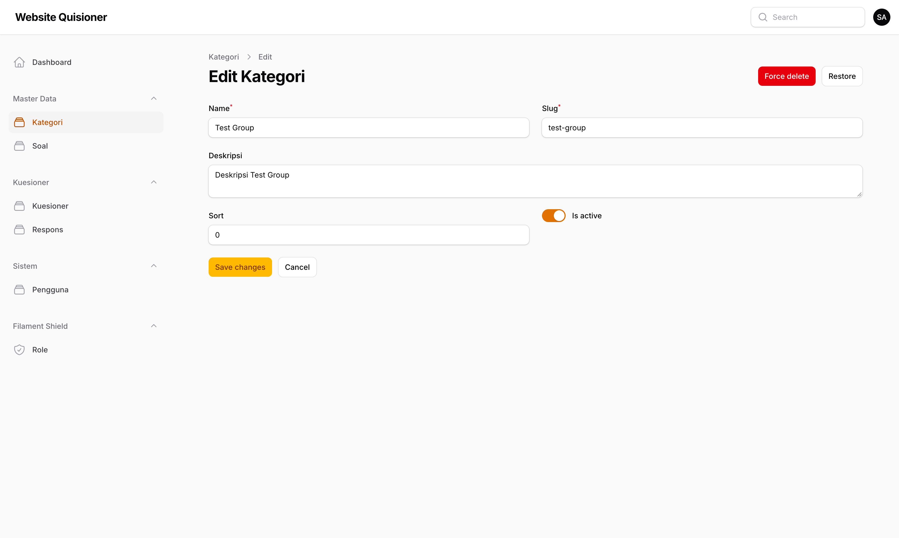

- **Restore** mengembalikan data yang soft-deleted.
- **Force Delete** menghapus data secara permanen.
- Perubahan atau penghapusan kategori tidak mengubah isi kuesioner yang sudah published karena kuesioner tersebut memakai snapshot.

---

## 5. Soal

Soal adalah pertanyaan yang dimasukkan ke kuesioner.

### 5.1 Halaman utama

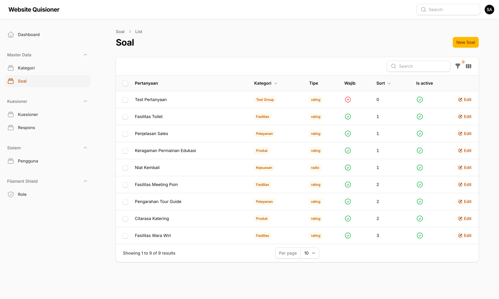

| Elemen | Fungsi |
|---|---|
| New Soal | Membuka form tambah soal |
| Search | Mencari pertanyaan |
| Filter | Membuka filter kategori dan data terhapus |
| Pertanyaan | Teks soal |
| Kategori | Kategori soal atau Umum |
| Tipe | Rating atau Radio |
| Wajib | Status wajib dijawab |
| Urutan | Urutan soal |
| Aktif | Status soal |
| Edit | Membuka form edit |

### 5.2 Filter

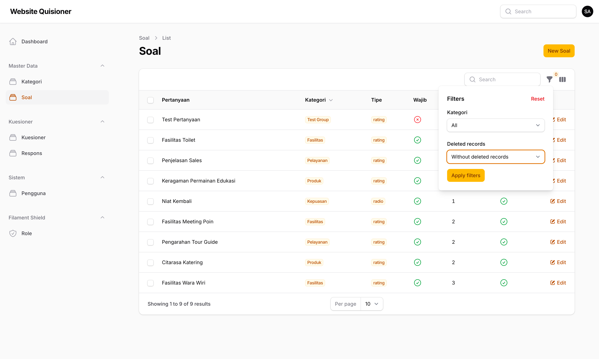

| Filter | Opsi | Perilaku |
|---|---|---|
| Kategori | `Semua` dan daftar kategori pada master | Membatasi soal berdasarkan kategori |
| Deleted records | `Without deleted records`, `With deleted records`, `Only deleted records` | Menentukan data yang ditampilkan |

Klik **Apply filters** untuk menerapkan.

### 5.3 Column manager

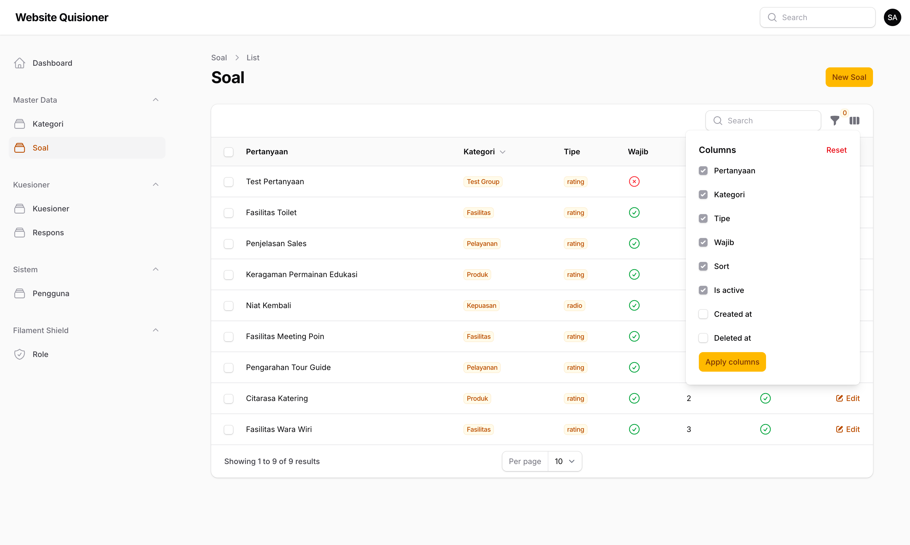

Column manager menampilkan atau menyembunyikan kolom tabel. Perubahan hanya memengaruhi tampilan.

### 5.4 Tambah soal

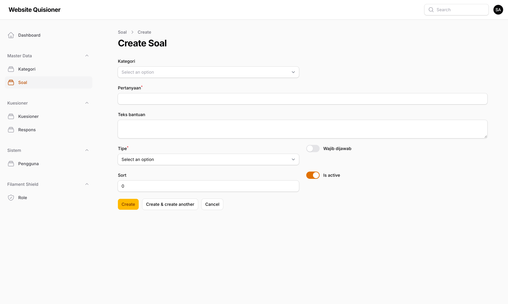

| Field | Keterangan |
|---|---|
| Kategori | Opsional. Kosong berarti Umum |
| Pertanyaan | Wajib diisi |
| Teks bantuan | Opsional. Tampil di bawah field |
| Tipe | Rating atau Radio |
| Skala min | Khusus rating. Harus lebih kecil dari skala max |
| Skala max | Khusus rating. Harus lebih besar dari skala min |
| Opsi | Khusus radio/select. Satu opsi per baris |
| Wajib dijawab | Menentukan validasi form publik |
| Urutan | Urutan soal |
| Aktif | Menentukan soal tersedia untuk kuesioner baru |

Catatan: form aplikasi saat ini hanya menyediakan tipe **Rating** dan **Radio**.

### 5.5 Edit dan delete

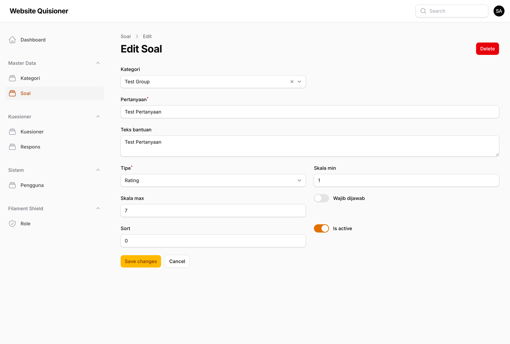

Langkah edit:

1. Klik **Edit**.
2. Ubah field yang diperlukan.
3. Klik **Save changes**.

Soft delete digunakan untuk menghapus soal dari tampilan biasa. Data masih dapat dipulihkan.

### 5.6 Restore dan force delete

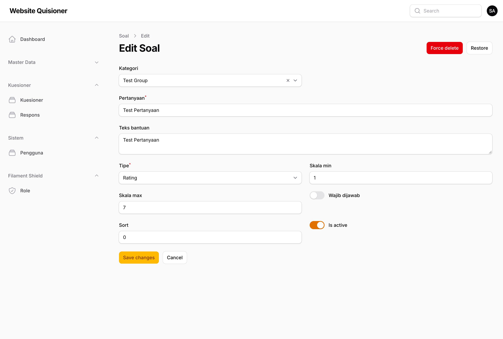

- **Restore** mengembalikan soal soft-deleted.
- **Force Delete** menghapus soal permanen.
- Soal yang dipakai kuesioner published tidak dapat dihapus permanen.

### 5.7 Pengaruh status aktif

Soal nonaktif tidak muncul pada pemilihan soal untuk kuesioner baru. Kuesioner published tetap memakai snapshot soal yang sudah dibekukan.

---

## 6. Kuesioner

Kuesioner menghubungkan soal, identitas responden, jadwal, dan tautan publik.

### 6.1 Halaman utama

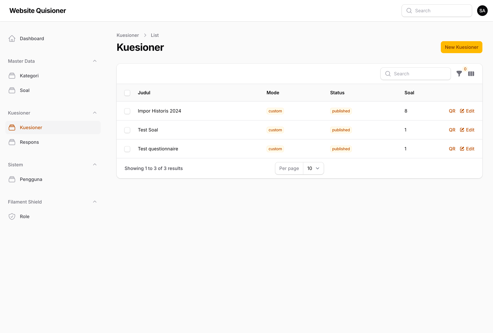

| Elemen | Fungsi |
|---|---|
| New Kuesioner | Membuka form tambah kuesioner |
| Search | Mencari judul kuesioner |
| Filter | Membuka filter status dan data terhapus |
| Judul | Judul kuesioner |
| Mode | Soal Only, Kategori, atau Custom/Mix |
| Status | Draft, Published, atau Closed |
| Soal | Jumlah soal pada snapshot |
| QR | Membuka QR dan tautan publik |
| Edit | Membuka form edit |

### 6.2 Filter

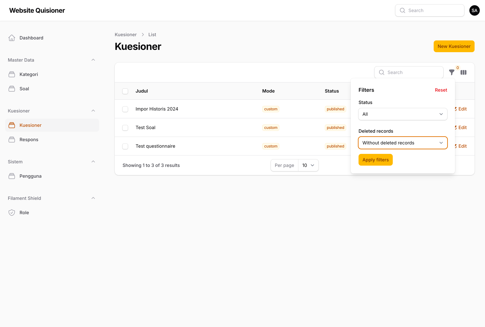

| Filter | Opsi | Perilaku |
|---|---|---|
| Status | `Draft`, `Published`, `Closed` | Membatasi kuesioner berdasarkan status |
| Deleted records | `Without deleted records`, `With deleted records`, `Only deleted records` | Menentukan data yang ditampilkan |

Klik **Apply filters** untuk menerapkan.

### 6.3 Column manager

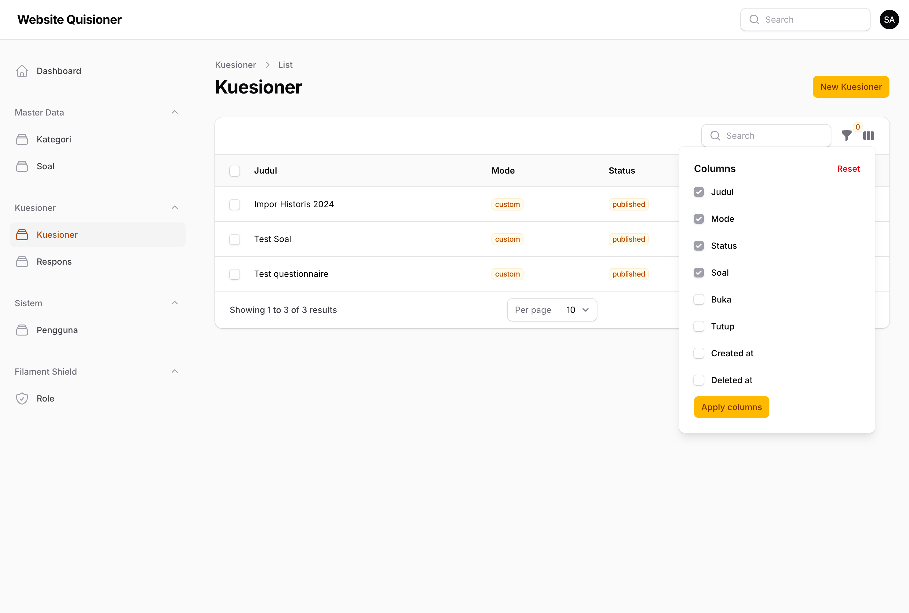

Column manager mengatur kolom yang ditampilkan. Pengaturan tidak mengubah data.

### 6.4 Tambah kuesioner

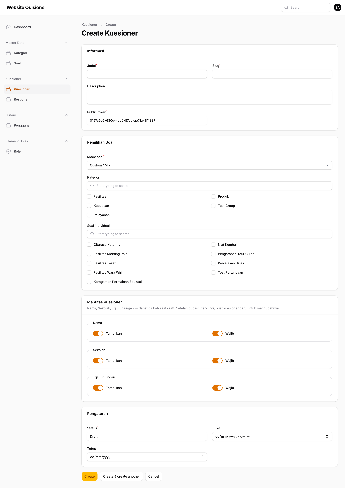

| Bagian | Field | Keterangan |
|---|---|---|
| Informasi | Judul | Wajib diisi |
| Informasi | Slug | Dibuat otomatis. Harus unik |
| Informasi | Deskripsi | Opsional |
| Informasi | Public token | UUID untuk tautan publik |
| Pemilihan Soal | Mode soal | Soal Only, Kategori, Custom/Mix |
| Pemilihan Soal | Kategori | Tampil untuk mode Kategori dan Custom |
| Pemilihan Soal | Soal individual | Tampil untuk mode Soal Only dan Custom |
| Identitas Kuesioner | Nama, Sekolah, Tgl Kunjungan | Tampilkan dan Wajib per field |
| Pengaturan | Status | Draft |
| Pengaturan | Buka | Waktu mulai |
| Pengaturan | Tutup | Waktu selesai |

Mode soal:

- **Soal Only**: hanya soal individual.
- **Kategori**: semua soal dari kategori yang dipilih.
- **Custom/Mix**: gabungan soal kategori dan soal individual.

### 6.5 Edit dan delete

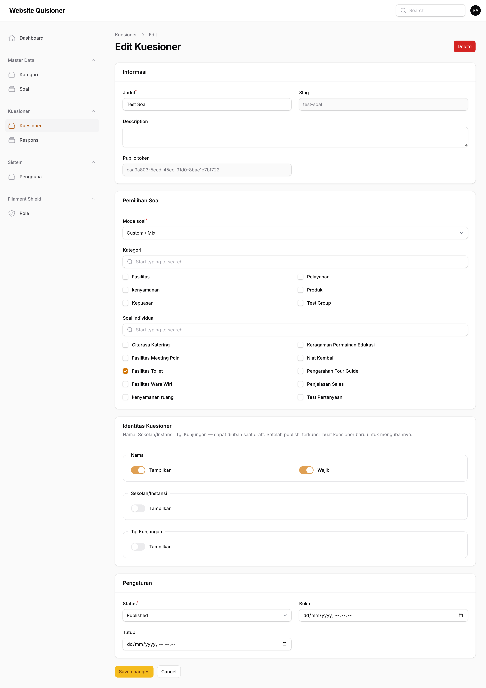

Langkah edit:

1. Klik **Edit**.
2. Ubah field yang masih diizinkan.
3. Klik **Save changes**.

Setelah kuesioner published:

- judul, deskripsi, tanggal buka, dan tanggal tutup masih dapat diubah
- slug dan public token terkunci
- identitas responden terkunci
- status hanya dapat diubah menjadi Closed
- perubahan soal/group tidak mengubah snapshot
- kuesioner tidak dapat dipublish ulang.

### 6.6 Restore dan force delete

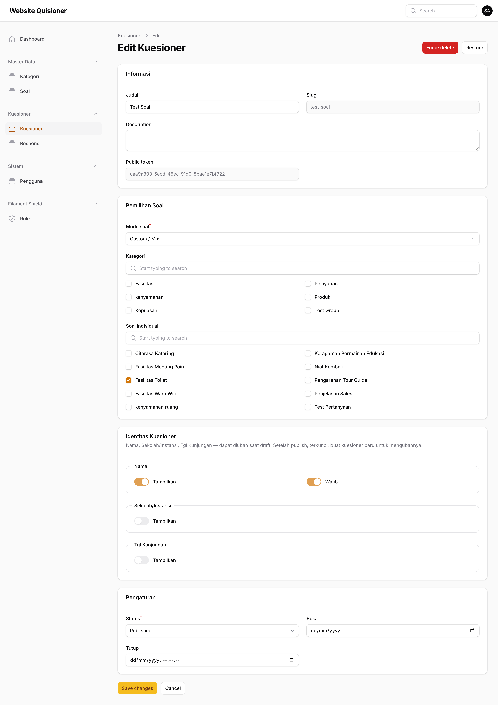

- **Restore** mengembalikan kuesioner soft-deleted.
- **Force Delete** menghapus kuesioner permanen.
- Respons yang terkait mengikuti relasi database yang berlaku.

### 6.7 Publish

Tombol **Publish** hanya muncul pada kuesioner berstatus Draft dan belum frozen. Setelah publish:

- soal dan group disimpan sebagai snapshot
- identitas responden dikunci
- status menjadi Published
- tombol Publish tidak muncul lagi.

Pesan konfirmasi:

```text
Setelah publish, soal, group, dan identitas responden terkunci. Buat kuesioner baru untuk perubahan.
```

### 6.8 QR dan share

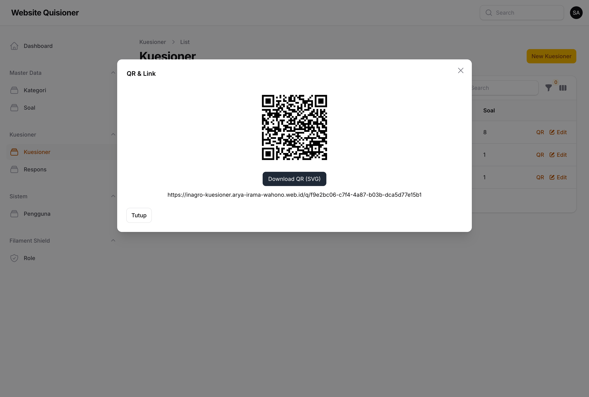

| Elemen | Fungsi |
|---|---|
| QR | Kode QR untuk tautan publik |
| Download QR (SVG) | Mengunduh QR berformat SVG |
| Link publik | Menampilkan URL `/q/{public_token}` |
| Tutup | Menutup dialog |

QR hanya tersedia untuk kuesioner berstatus Published. Tautan pada gambar hanya contoh. Gunakan alamat deployment aktual.

Langkah berbagi:

1. Klik **QR**.
2. Unduh **Download QR (SVG)** bila QR akan dicetak.
3. Salin tautan publik bila akan dibagikan melalui pesan atau media lain.
4. Klik **Tutup**.

---

## 7. Form Publik

Form publik dibuka melalui tautan `/q/{public_token}`. Responden tidak perlu login.

### 7.1 Identitas

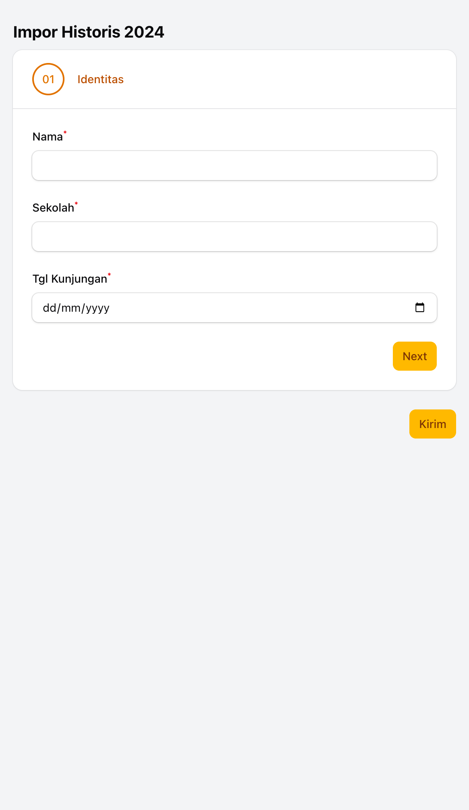

| Elemen | Fungsi |
|---|---|
| Nama | Identitas responden. Dapat disembunyikan atau tidak wajib |
| Sekolah | Identitas sekolah. Dapat disembunyikan atau tidak wajib |
| Tgl Kunjungan | Tanggal kunjungan. Dapat disembunyikan atau tidak wajib |
| Next | Berpindah ke langkah berikutnya |
| Kirim | Mengirim jawaban |

Step Identitas dilewati jika ketiga field disembunyikan.

### 7.2 Soal rating

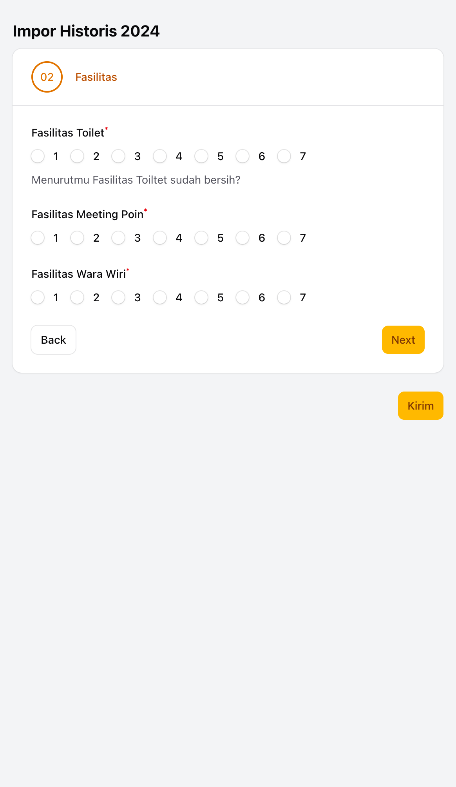

Soal rating menampilkan pilihan angka sesuai `scale_min` sampai `scale_max`. Contoh pada gambar menggunakan skala 1 sampai 7. Pilih satu angka, lalu klik **Next**.

### 7.3 Soal radio

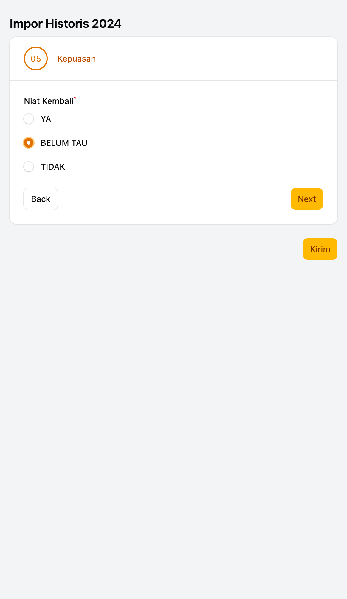

Soal radio menampilkan opsi teks. Pilih satu opsi, lalu klik **Next**.

### 7.4 Review

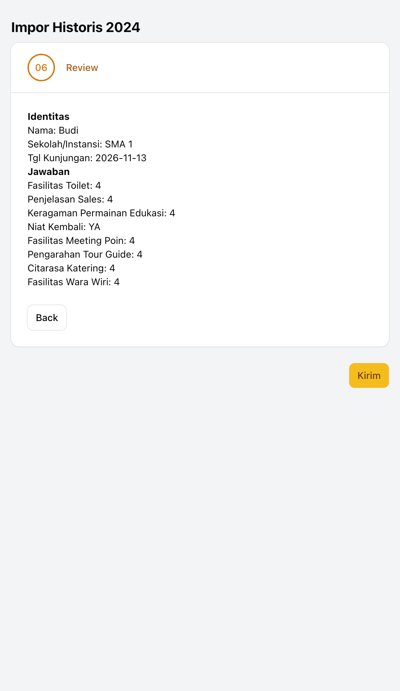

Halaman Review menampilkan identitas dan jawaban yang akan dikirim. Periksa seluruh nilai sebelum mengirim.

### 7.5 Sukses

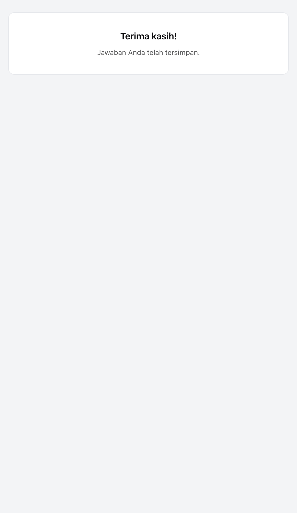

Setelah submit berhasil, sistem menampilkan pesan terima kasih. Respons tersimpan dengan status Submitted.

### 7.6 Autosave dan device token

- Draft dibuat saat field pertama diubah, bukan saat halaman dibuka.
- Token draft disimpan pada session dan cookie browser per kuesioner.
- Satu browser/perangkat tidak dapat mengirim dua kali pada kuesioner yang sama.
- Kuesioner berbeda menggunakan token berbeda, sehingga perangkat yang sama dapat mengisi kuesioner lain.
- Identitas, nama, sekolah, tanggal, dan IP tidak dipakai untuk memblokir duplikat.
- Jika cookie dihapus atau browser diganti, pengiriman ulang masih mungkin terjadi.

### 7.7 Kuesioner tidak dapat dibuka

Akses ditolak jika:

- status bukan Published
- waktu sekarang sebelum `opens_at`
- waktu sekarang setelah `closes_at`
- token tidak ditemukan.

Pesan yang mungkin muncul:

```text
Kuesioner belum dibuka.
```

```text
Kuesioner sudah ditutup.
```

---

## 8. Respons

Halaman Respons menampilkan respons draft dan submitted.

### 8.1 Halaman utama

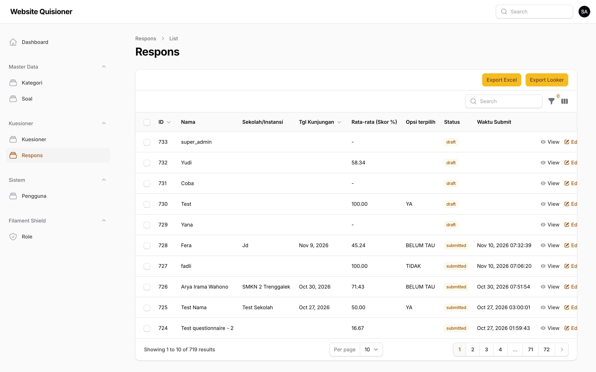

| Elemen | Fungsi |
|---|---|
| Export Excel | Mengunduh XLSX wide |
| Export Looker | Mengunduh XLSX 15 kolom |
| Search | Mencari nama atau sekolah |
| Filter | Membuka panel filter |
| Column manager | Mengatur kolom |
| ID | ID respons |
| Nama | Nama responden |
| Sekolah | Sekolah responden |
| Tgl Kunjungan | Tanggal kunjungan |
| Rata-rata (Skor %) | Rata-rata skor jawaban numerik |
| Opsi terpilih | Opsi radio/select yang dipilih |
| Status | Draft atau Submitted |
| Waktu Submit | Waktu pengiriman |
| View | Membuka detail respons |
| Edit | Mengubah nama dan sekolah |

Urutan default adalah ID terbaru di atas. Tabel menggunakan pagination.

### 8.2 Filter

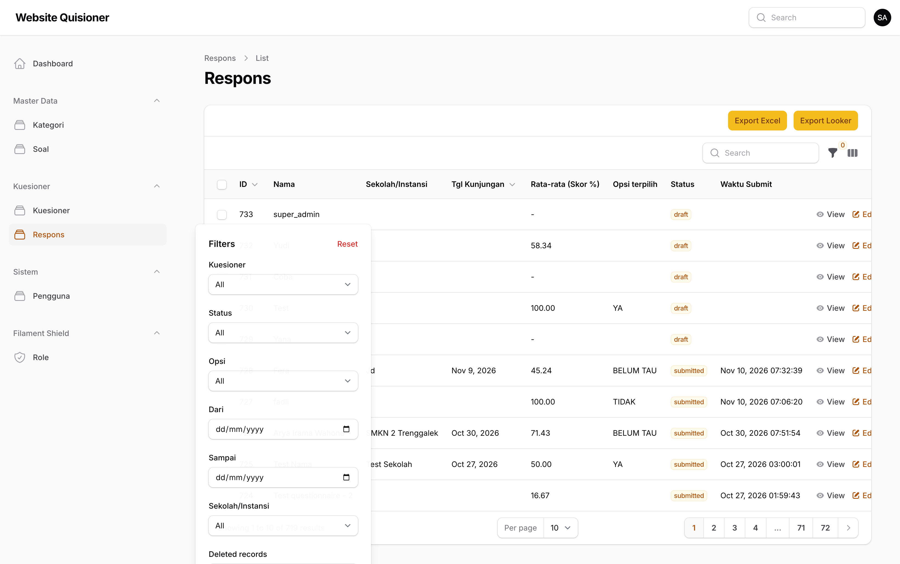

| Filter | Opsi | Perilaku |
|---|---|---|
| Kuesioner | `Semua` dan daftar judul kuesioner | Membatasi satu kuesioner |
| Status | `Draft`, `Submitted` | Membatasi status respons |
| Opsi | `Semua` dan daftar nilai `value_option` yang ada | Membatasi jawaban yang memiliki opsi tersebut |
| Dari | Date picker | Batas awal `visit_date` |
| Sampai | Date picker | Batas akhir `visit_date` |
| Sekolah | `Semua` dan daftar `respondent_school` yang ada | Membatasi sekolah |
| Deleted records | `Without deleted records`, `With deleted records`, `Only deleted records` | Menentukan data yang ditampilkan |

Catatan:

- Daftar **Opsi** dan **Sekolah** bersifat dinamis mengikuti data yang ada.
- Filter tanggal mencakup batas awal dan batas akhir.
- Export hanya mengambil data submitted dan selalu mengecualikan soft-deleted.

Klik **Apply filters** untuk menerapkan dan **Reset** untuk mengosongkan filter.

### 8.3 Column manager

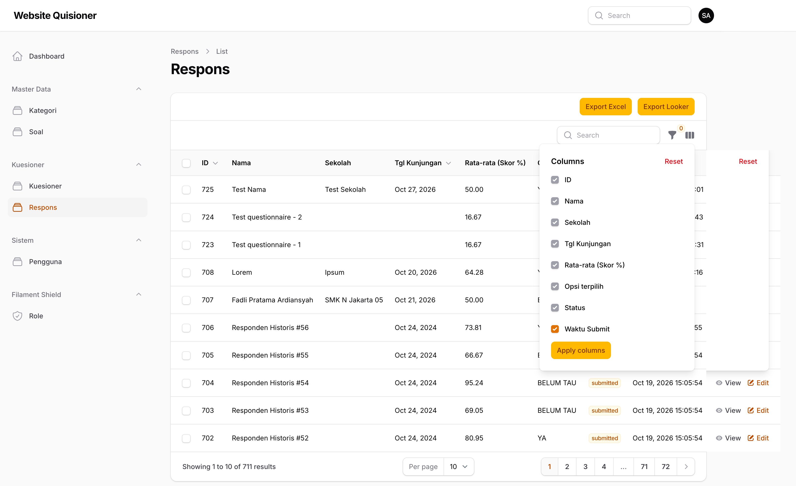

Column manager menampilkan atau menyembunyikan kolom. Pengaturan tidak mengubah data.

### 8.4 Detail respons

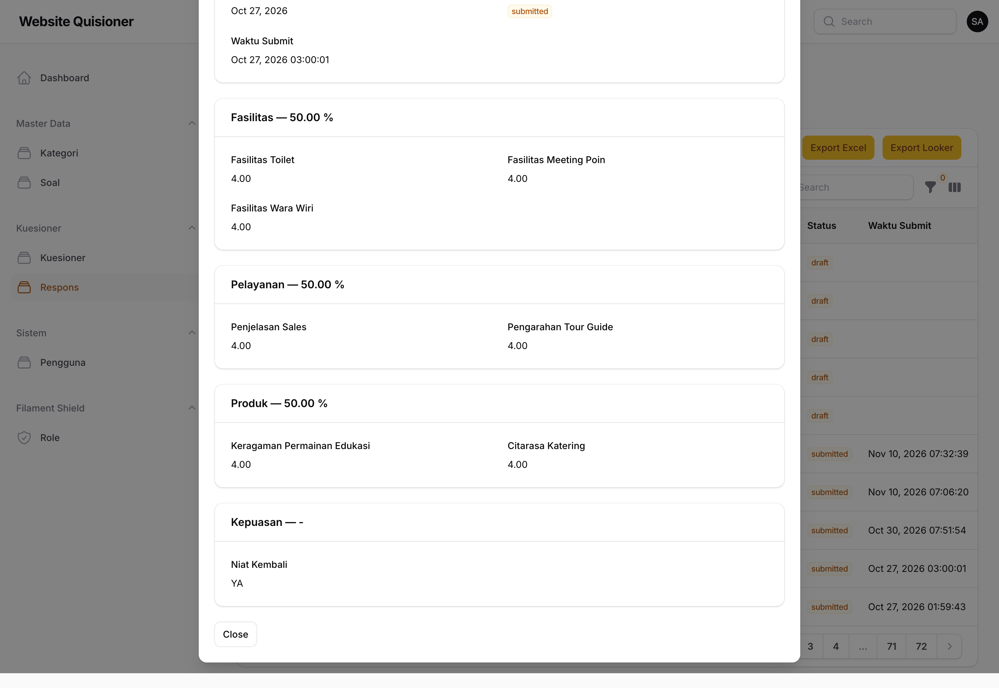

Detail respons menampilkan:

- identitas responden
- status dan waktu submit
- jawaban per kategori
- rata-rata Skor % per kategori.

Nama kategori, label soal, dan skala pada detail menggunakan snapshot kuesioner.

### 8.5 Edit dan delete

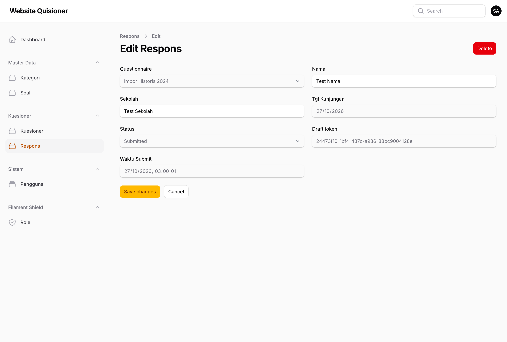

Edit respons hanya mengizinkan perubahan:

- Nama
- Sekolah.

Field kuesioner, status, draft token, waktu submit, dan tanggal kunjungan tidak dapat diubah dari form edit.

Delete adalah soft delete. Data dapat dipulihkan.

### 8.6 Restore dan force delete

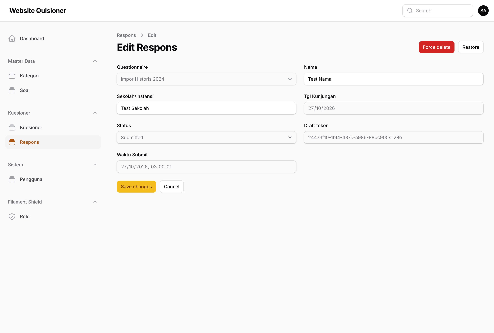

- **Restore** mengembalikan respons soft-deleted.
- **Force Delete** menghapus respons permanen.
- Respons soft-deleted tidak pernah masuk export.

### 8.7 Tambah respons

Halaman admin tidak menyediakan tombol tambah respons. Respons hanya dibuat melalui form publik.

---

## 9. Export Excel dan Looker

Export tersedia pada halaman Respons dan memerlukan permission `export_response`.

### 9.1 Tombol export


| Tombol | Hasil |
|---|---|
| Export Excel | File XLSX wide |
| Export Looker | File XLSX long 15 kolom |

Kedua export:

- hanya mengambil respons Submitted
- mengecualikan respons soft-deleted
- mengikuti filter dan pencarian yang sudah diterapkan
- tidak mengikuti pagination
- mengurutkan respons dari ID terbaru ke terlama.

### 9.2 Export Excel

Header wide:

```text
ID
KUESIONER_ID
KUESIONER
NAMA
SEKOLAH
TGL KUNJUNGAN
WAKTU SUBMIT
[label soal]
RATA RATA ALL (Skor %)
```

Perilaku kolom soal:

- Jika filter **Kuesioner** dipilih, kolom soal mengikuti snapshot kuesioner tersebut.
- Jika filter **Kuesioner** tidak dipilih, kolom soal diambil dari master soal.
- Untuk menjaga konsistensi snapshot, pilih satu kuesioner sebelum menjalankan export wide.

Nama file:

```text
responses_wide_YYYYMMDD_HHmm.xlsx
```

### 9.3 Export Looker

Header Looker:

```text
response_id
submitted_at
visit_date
respondent_name
respondent_school
questionnaire
questionnaire_slug
public_token
category
question
question_type
score
option
scale_min
scale_max
```

Satu baris mewakili satu jawaban.

Label soal, category, question type, scale min, dan scale max diambil dari snapshot kuesioner. Jika `visit_date` kosong, kolom `visit_date` tetap kosong pada file.

Nama file:

```text
looker_answers_YYYYMMDD_HHmm.xlsx
```

### 9.4 Append Looker ke Google Sheets

1. Buka Google Sheets tujuan.
2. Pilih **File**.
3. Pilih **Import**.
4. Pilih **Upload**.
5. Pilih file Looker.
6. Pilih **Append rows to current sheet**.
7. Pastikan urutan dan nama 15 kolom tidak diubah.
8. Klik **Import data**.
9. Refresh Looker Studio.

Duplikat baris dibiarkan. Filter yang aktif pada tabel hanya mengekspor subset yang sesuai filter.

---

## 10. Pengguna

Halaman Pengguna digunakan untuk mengelola akun admin.

### 10.1 Halaman utama

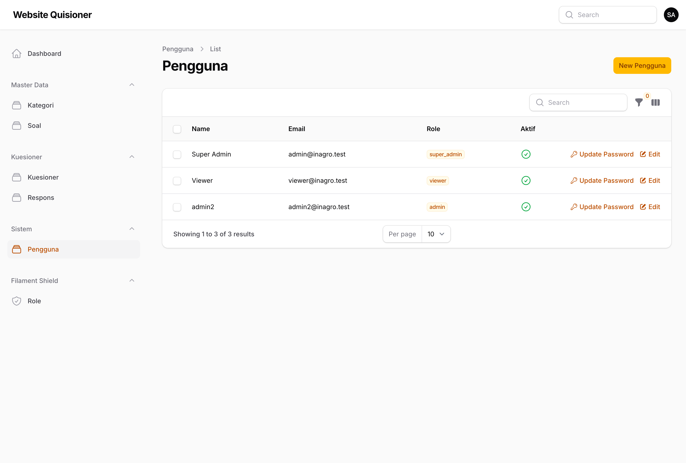

| Elemen | Fungsi |
|---|---|
| New Pengguna | Membuka form tambah pengguna |
| Search | Mencari nama atau email |
| Filter | Membuka filter data terhapus |
| Nama | Nama pengguna |
| Email | Email login |
| Role | Role pengguna |
| Aktif | Status login |
| Update Password | Mengubah password pengguna |
| Edit | Membuka form edit |

### 10.2 Filter

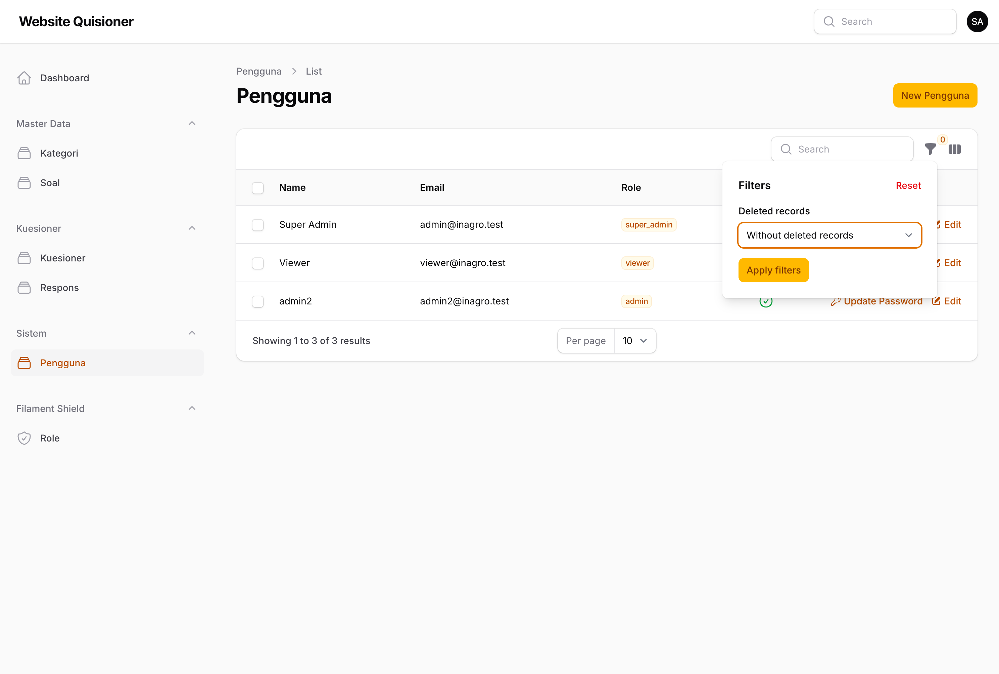

| Filter | Opsi | Perilaku |
|---|---|---|
| Deleted records | `Without deleted records`, `With deleted records`, `Only deleted records` | Menentukan data pengguna yang ditampilkan |

### 10.3 Tambah pengguna

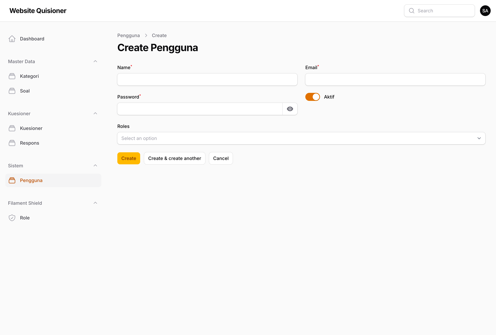

| Field | Keterangan |
|---|---|
| Nama | Wajib diisi |
| Email | Wajib, unik, format email |
| Password | Wajib saat membuat pengguna |
| Aktif | Menentukan akses login |
| Role | Hanya tampil jika pengguna memiliki permission `assign_role` |

Pengguna dengan permission `assign_role` dapat memberikan role apa pun, termasuk `super_admin`.

### 10.4 Edit dan delete

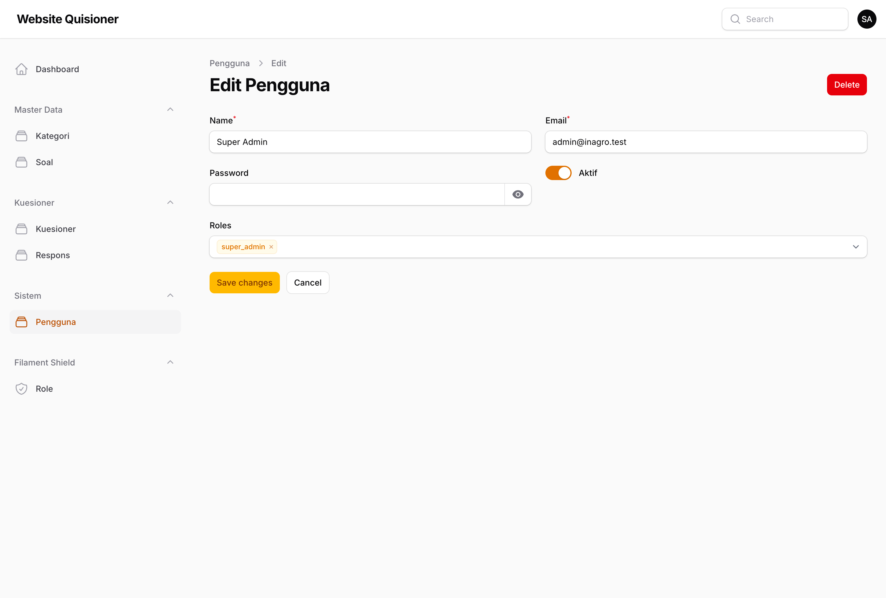

Edit digunakan untuk mengubah nama, email, status aktif, dan role. Delete adalah soft delete.

Pengguna tidak dapat menonaktifkan atau menghapus akun sendiri. Super Admin terakhir yang aktif juga tidak dapat dinonaktifkan atau dihapus.

### 10.5 Update password

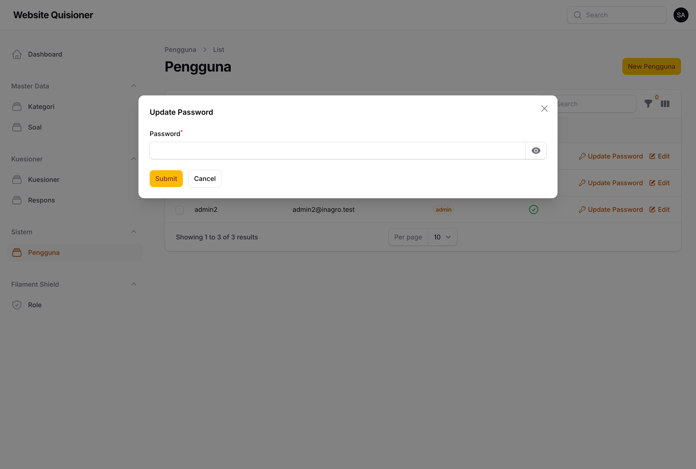

Langkah:

1. Klik **Update Password**.
2. Isi password baru minimal 8 karakter.
3. Klik tombol simpan.

Password langsung berlaku. Tidak ada email verifikasi atau reset password mandiri.

### 10.6 Restore dan force delete

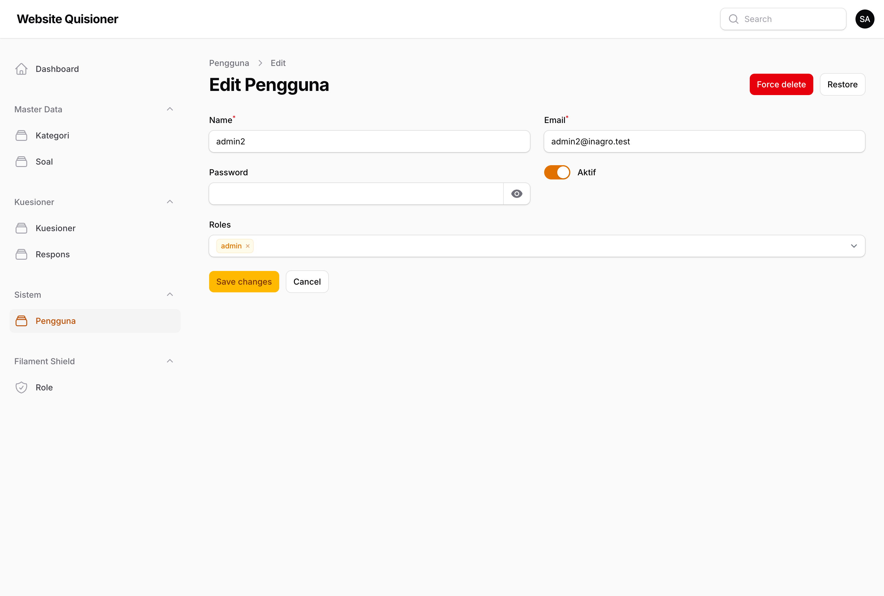

- **Restore** mengembalikan pengguna soft-deleted.
- **Force Delete** menghapus pengguna permanen.

### 10.7 Login terakhir

Waktu login terakhir diperbarui setiap login berhasil. Login gagal tidak mengubah nilai tersebut.

---

## 11. Role dan Permission

Halaman Role dikelola melalui Filament Shield.

### 11.1 Halaman utama

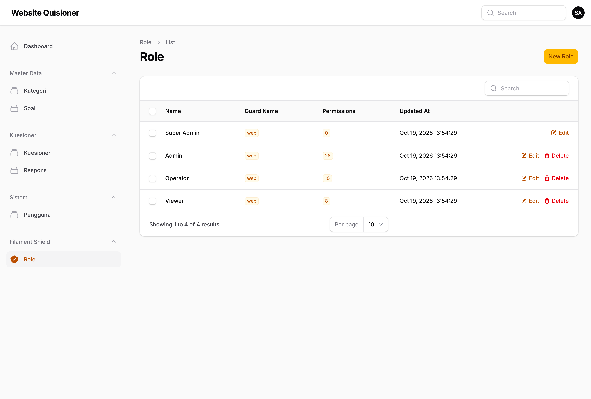

| Elemen | Fungsi |
|---|---|
| New Role | Membuka form tambah role |
| Search | Mencari nama role |
| Name | Nama role |
| Guard Name | Guard autentikasi, umumnya `web` |
| Permissions | Jumlah permission yang dimiliki role |
| Edit | Membuka halaman permission |
| Delete | Menghapus role selain `super_admin` |

Role contoh:

| Role | Permission |
|---|---:|
| Super Admin | 0. Akses bypass |
| Admin | 32 |
| Operator | 14 |
| Viewer | 12 |

Jumlah tersebut dapat berubah sesuai permission yang diberikan.

Halaman Role tidak memiliki filter. Pencarian hanya menggunakan kolom Search berdasarkan nama role.

### 11.2 Tambah role

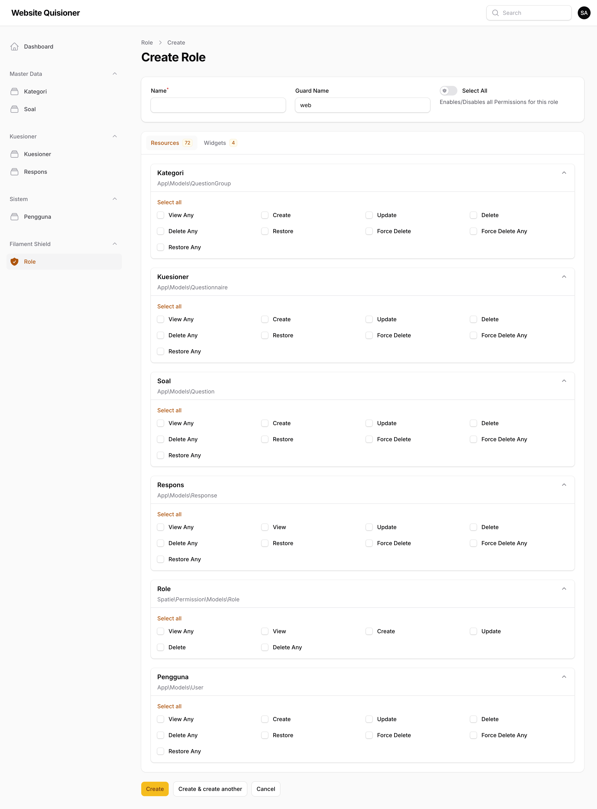

| Elemen | Fungsi |
|---|---|
| Name | Nama role |
| Guard Name | Guard permission |
| Select All | Memilih atau membatalkan semua permission |
| Resources | Tab permission resource |
| Widgets | Tab permission widget dashboard |
| Create | Menyimpan role |
| Create & create another | Menyimpan dan membuka form baru |
| Cancel | Membatalkan |

Permission **Resources** mencakup Kategori, Kuesioner, Soal, Respons, Role, dan Pengguna. Permission **Widgets** mencakup:

```text
View:StatsOverview
View:ResponsesPerMonthChart
View:OptionDistributionChart
View:LowestCriteriaTable
```

Jangan gunakan **Select All** untuk role operasional. Pilih hanya permission yang dibutuhkan.

### 11.3 Edit dan delete role

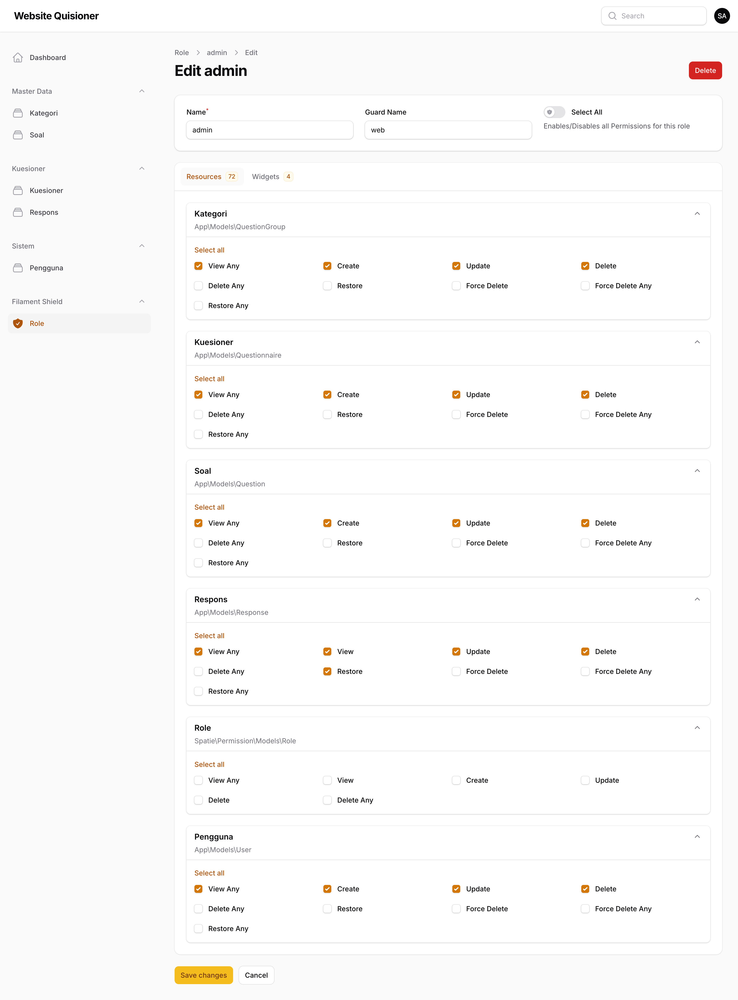

Langkah edit:

1. Klik **Edit** pada role.
2. Buka tab **Resources** atau **Widgets**.
3. Centang atau hapus centang permission.
4. Klik **Save changes**.

Role `super_admin` tidak dapat dihapus. Role lain dapat dihapus jika tidak lagi digunakan.

### 11.4 Permission widget

Widget dashboard memakai `HasWidgetShield`. Jika role tidak memiliki permission widget, widget tidak tampil. Role Admin, Operator, dan Viewer sudah memiliki keempat permission widget secara default.

### 11.5 Permission role assignment

Field role pada form Pengguna hanya tampil jika pengguna memiliki permission `assign_role`. Pemegang permission tersebut dapat memberikan role apa pun, termasuk `super_admin`.

---

## 12. Troubleshooting

### 12.1 Tidak dapat login

| Penyebab | Tindakan |
|---|---|
| Email atau password salah | Periksa kembali data login |
| Akun nonaktif | Hubungi Admin atau Super Admin |
| Akun soft-deleted | Minta Admin melakukan restore |
| Lupa password | Minta Admin mengubah password melalui halaman Pengguna |

Pesan akun nonaktif:

```text
Akun dinonaktifkan, hubungi admin.
```

### 12.2 Kuesioner tidak dapat dibuka

| Pesan | Penyebab |
|---|---|
| `Kuesioner belum dibuka.` | Status belum Published atau waktu buka belum tiba |
| `Kuesioner sudah ditutup.` | Waktu tutup sudah lewat |
| Halaman tidak ditemukan | Token tidak valid |

Periksa status, `opens_at`, dan `closes_at` pada kuesioner.

### 12.3 Tombol Publish tidak muncul

Tombol Publish hanya muncul jika:

- status Draft
- kuesioner belum frozen
- pengguna memiliki permission `publish_questionnaire`.

Kuesioner yang sudah published tidak dapat dipublish ulang. Buat kuesioner baru untuk perubahan isi.

### 12.4 Identitas tidak dapat diubah

Identitas kuesioner terkunci setelah publish. Buat kuesioner baru jika konfigurasi identitas harus berubah.

### 12.5 QR tidak muncul

QR hanya tampil pada kuesioner Published. Kuesioner Draft atau Closed tidak menampilkan tombol QR.

### 12.6 Widget dashboard tidak tampil

Periksa tab **Widgets** pada role pengguna. Permission yang diperlukan:

```text
View:StatsOverview
View:ResponsesPerMonthChart
View:OptionDistributionChart
View:LowestCriteriaTable
```

Jika permission tidak dicentang, widget disembunyikan.

### 12.7 Export kosong

Periksa:

- filter Kuesioner
- filter Status
- filter tanggal
- filter Sekolah
- filter Opsi
- data draft tidak ikut export
- respons soft-deleted tidak ikut export.

Export wide tanpa filter kuesioner memakai master soal. Pilih satu kuesioner untuk memakai snapshot.

### 12.8 Looker `visit_date` kosong

Kolom `visit_date` kosong jika respons tidak memiliki tanggal kunjungan. Baris tetap diekspor, tetapi tidak memiliki tanggal kunjungan pada file Looker.

### 12.9 Tidak bisa submit dua kali

Satu browser/perangkat hanya dapat submit satu kali pada kuesioner yang sama. Untuk kuesioner baru, gunakan tautan kuesioner baru. Menghapus cookie atau memakai browser lain memungkinkan pengiriman ulang.

### 12.10 Role tidak bisa diubah

Field role hanya tersedia jika pengguna memiliki permission `assign_role`. Minta Super Admin memberikan permission tersebut melalui halaman Role.

### 12.11 Super Admin tidak bisa dinonaktifkan

Sistem mencegah penonaktifan atau penghapusan akun sendiri dan mencegah hilangnya Super Admin aktif terakhir.

---

## 13. Lampiran

### 13.1 Matriks permission role

| Resource | Viewer | Operator | Admin |
|---|---|---|---|
| Kategori | View | View | View, Create, Update, Delete |
| Soal | View | View | View, Create, Update, Delete |
| Kuesioner | View | View | View, Create, Update, Delete, Publish |
| Respons | View | View, Update, Export | View, Update, Delete, Restore, Export |
| Pengguna | — | — | View, Create, Update, Delete |
| Role | — | — | — |
| Widget dashboard | 4 permission | 4 permission | 4 permission |

Super Admin memiliki akses penuh melalui bypass.

### 13.2 Matriks filter

| Halaman | Filter | Opsi |
|---|---|---|
| Kategori | Deleted records | Without deleted records, With deleted records, Only deleted records |
| Soal | Kategori | Semua dan daftar kategori |
| Soal | Deleted records | Without deleted records, With deleted records, Only deleted records |
| Kuesioner | Status | Draft, Published, Closed |
| Kuesioner | Deleted records | Without deleted records, With deleted records, Only deleted records |
| Respons | Kuesioner | Semua dan daftar judul |
| Respons | Status | Draft, Submitted |
| Respons | Opsi | Semua dan nilai opsi yang ada |
| Respons | Dari/Sampai | Date picker |
| Respons | Sekolah | Semua dan sekolah yang ada |
| Respons | Deleted records | Without deleted records, With deleted records, Only deleted records |
| Pengguna | Deleted records | Without deleted records, With deleted records, Only deleted records |
| Dashboard Distribusi Opsi | Soal | Soal radio/select dari kuesioner terpilih |
| Dashboard Distribusi Opsi | Kuesioner | Semua dan daftar judul |
| Dashboard Distribusi Opsi | Dari/Sampai | Date picker |
| Dashboard Respons/Bulan | Kuesioner | Semua dan daftar judul |
| Dashboard Respons/Bulan | Dari/Sampai | Date picker |
| Role | — | Tidak ada filter |

### 13.3 Perbedaan tanggal

| Bagian | Sumber tanggal |
|---|---|
| Filter Respons | `visit_date` |
| Distribusi Opsi | `visit_date` |
| Respons/Bulan | `COALESCE(visit_date, created_at)` |
| Looker | `visit_date`. Kosong jika tidak ada |

### 13.4 Daftar gambar

1. `login/login.png`
2. `login/login-salah-password.png`
3. `dashboard/dashboard-initial.png`
4. `dashboard/dashboard-filter-radio-question.png`
5. `dashboard/dashboard-filter-range-question.png`
6. `kategori/kategori-table.png`
7. `kategori/kategori-table-filter.png`
8. `kategori/kategori-table-visibility-column.png`
9. `kategori/kategori-create.png`
10. `kategori/kategori-edit-delete.png`
11. `kategori/kategori-edit-force-delete-restore.png`
12. `soal/soal-table.png`
13. `soal/soal-table-filter.png`
14. `soal/soal-table-visibility-column.png`
15. `soal/soal-create.png`
16. `soal/soal-edit-delete.png`
17. `soal/soal-edit-force-delete-restore.png`
18. `kuesioner/kuesioner-table.png`
19. `kuesioner/kuesioner-table-filter.png`
20. `kuesioner/kuesioner-table-visibility-column.png`
21. `kuesioner/kuesioner-create.png`
22. `kuesioner/kuesioner-edit-delete.png`
23. `kuesioner/kuesioner-edit-force-delete-restore.png`
24. `kuesioner/kuesioner-qrcode.png`
25. `publik/data-diri.png`
26. `publik/soal-tipe-rating.png`
27. `publik/soal-tipe-radio.png`
28. `publik/review-answer.png`
29. `publik/submit-quiz-success.png`
30. `respons/respons-table.png`
31. `respons/respons-table-filter.png`
32. `respons/respons-table-visibility-column.png`
33. `respons/respons-view.png`
34. `respons/respons-edit-delete.png`
35. `respons/respons-edit-force-delete-restore.png`
36. `pengguna/pengguna-table.png`
37. `pengguna/pengguna-table-filter.png`
38. `pengguna/pengguna-create.png`
39. `pengguna/pengguna-edit-delete.png`
40. `pengguna/pengguna-update-password.png`
41. `pengguna/pengguna-edit-force-delete-restore.png`
42. `role/role-table.png`
43. `role/role-create.png`
44. `role/role-edit-delete.png`
# manualbook-inagro-kuisioner
